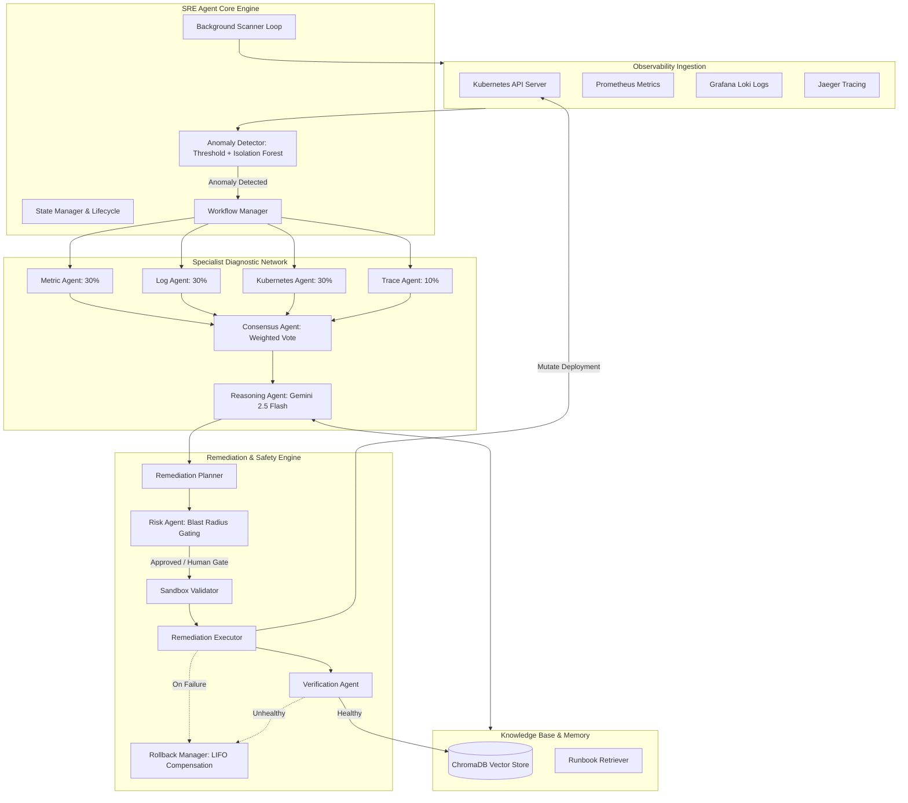

# Autonomous SRE Agent for Cloud Systems

An autonomous, self-healing Site Reliability Engineering (SRE) service designed to monitor Kubernetes workloads, detect anomalies, analyze root causes (RCA) via multi-agent consensus and Google Gemini 2.5 Flash, and execute safe, verified remediation procedures with automatic rollback guarantees.

---

## 1. System Architecture



---

## 2. Key Features

- **Multi-Modal Diagnostic Agents**: 4 concurrent specialist agents (Metric, Log, Kubernetes, Trace) evaluating telemetry in parallel.
- **Deep LLM Reasoning**: Integrates **Google Gemini 2.5 Flash** for contextual RCA, semantic runbook interpretation, and remediation plan synthesis.
- **Dual-Mode Operation**: Seamlessly operates in **Live Kubernetes Mode** (connected to real cluster via `kubeconfig`) or **Simulation Mode** (deterministic offline fast-fallback for zero-dependency testing).
- **Safety & Risk Gating**: Pre-execution sandbox validation, dry-run safety gates, and human approval workflow (`needs_human` status).
- **Automated Rollback Guarantee**: Tracks every executed step and automatically triggers reverse compensatory actions (LIFO) if post-remediation verification checks fail.
- **Vector Incident Memory**: Automatically indexes postmortem reports and operational runbooks into **ChromaDB** using dense embeddings (`all-MiniLM-L6-v2`) for historical incident recall.

---

## 3. Quick Start

### 3.1 Prerequisites
- Python 3.10+ (Python 3.12 recommended)
- Google Gemini API Key ([Google AI Studio](https://aistudio.google.com/))
- Docker Desktop (optional, for running containerized infrastructure)

### 3.2 Configuration (`.env`)
Create or update `.env` in `autonomous-sre-agent/.env`:
```ini
# LLM Configuration
GEMINI_API_KEY=your_gemini_api_key_here
LLM_MODEL=gemini-2.5-flash
LLM_MAX_TOKENS=4096
LLM_TEMPERATURE=0.1

# Kubernetes Configuration
KUBECONFIG_PATH=C:\Users\<Your_Username>\.kube\config
K8S_IN_CLUSTER=false
K8S_NAMESPACE=default

# Automation Safety Gates
AUTO_REMEDIATE=false
DRY_RUN=true
RISK_THRESHOLD=medium
REMEDIATION_CONFIDENCE_THRESHOLD=0.85

# Observability Endpoints
PROMETHEUS_URL=http://localhost:9090
LOKI_URL=http://localhost:3100
JAEGER_URL=http://localhost:16686
```

### 3.3 Running Locally
```powershell
cd autonomous-sre-agent

# 1. Create and activate virtual environment
py -3.12 -m venv .venv
.\.venv\Scripts\activate

# 2. Install dependencies
pip install -r requirements.txt

# 3. Start the FastAPI service
$env:PYTHONPATH="."
.\.venv\Scripts\python.exe -m uvicorn app.main:app --reload --port 8000
```
Interactive Swagger API documentation is available at `http://localhost:8000/docs`.

---

## 4. Real-Time Verification & Test Suite

### 4.1 Automated Unit Tests (10/10 Passing)
Covers all specialist agents, RCA engine, remediation planner, sandbox validator, rollback manager, and workflow state transitions:
```powershell
cd autonomous-sre-agent
$env:PYTHONPATH="."
.\.venv\Scripts\python.exe -m pytest tests/ -v
```

---

### 4.2 End-to-End Live Simulation with Gemini 2.5 Flash
Executes the complete self-healing lifecycle using live Google Gemini 2.5 Flash reasoning:
```powershell
cd autonomous-sre-agent
$env:PYTHONPATH="."
.\.venv\Scripts\python.exe tests/test_live_simulation.py
```

**Verified Workflow Steps:**
1. **Anomaly Detected**: Identifies simulated runaway memory and crashlooping container on `payment-api`.
2. **Multi-Agent Diagnostics**: Metric (85%), Log (95% OOM), Kubernetes (95% CrashLoop), and Trace agents analyze telemetry in parallel.
3. **Gemini 2.5 Flash Consensus**: Gemini reconciles specialist outputs and identifies `memory_leak` with 95% confidence.
4. **Context Retrieval**: Queries ChromaDB vector store for matching runbooks and past incidents.
5. **Remediation Planning**: Synthesizes a safe remediation plan (`scale_deployment` to 5 replicas).
6. **Safety Gate & Approval**: Flags `needs_human` due to safety policy, simulates operator approval, and validates via sandbox.
7. **Execution & Rollback Log**: Scales deployment and records reverse action in `RollbackManager`.
8. **Recovery Verification**: Verifies recovery telemetry (CPU 15.4%, Memory 45.2%, Pods Ready) and transitions state to `RESOLVED`.
9. **Vector Indexing & Postmortem**: Automatically renders full Markdown postmortem and indexes it into ChromaDB.

---

### 4.3 Live Kubernetes Cluster Auto-Remediation Verification
Verified directly against an active Kubernetes cluster (`desktop-control-plane` via Docker Desktop):

#### 1. Cluster Discovery & Health Check
```powershell
cd autonomous-sre-agent
$env:PYTHONPATH="."
.\.venv\Scripts\python.exe tests/verify_k8s.py
```
*Discovers live cluster nodes, fetches running pods, and validates Kubernetes API connectivity.*

#### 2. Live Automated Cluster Scaling
```powershell
$env:PYTHONPATH="."
.\.venv\Scripts\python.exe tests/verify_scaling.py
```
*Validates the deployment via `SandboxValidator`, executes live scaling from 1 to 3 replicas against the Kubernetes API server, and confirms replica readiness.*

#### 3. Confirm in Kubernetes:
```powershell
kubectl get pods
```
```text
NAME                          READY   STATUS    RESTARTS   AGE
nginx-test-66cf5ddf9b-kmmbc   1/1     Running   0          3m
nginx-test-66cf5ddf9b-pdsfh   1/1     Running   0          9m
nginx-test-66cf5ddf9b-rv8j2   1/1     Running   0          3m
```

---

## 5. API Reference

| Method | Endpoint | Description |
| :--- | :--- | :--- |
| `GET` | `/health` | Health status and version check. |
| `GET` | `/api/incidents` | List all tracked incidents across all lifecycle states. |
| `GET` | `/api/incidents/{id}` | Detailed incident state, telemetry, RCA results, and plan execution logs. |
| `POST` | `/api/incidents/{id}/approve` | Human approval trigger for gated remediations in `needs_human` status. |
| `POST` | `/api/trigger` | Manually triggers an immediate monitoring scan across a namespace. |
| `GET` | `/api/dashboard` | High-level metrics: total incidents, resolution rate, and root-cause distributions. |
| `GET` | `/api/incidents/{id}/report` | Returns rendered Markdown SRE postmortem summary. |
