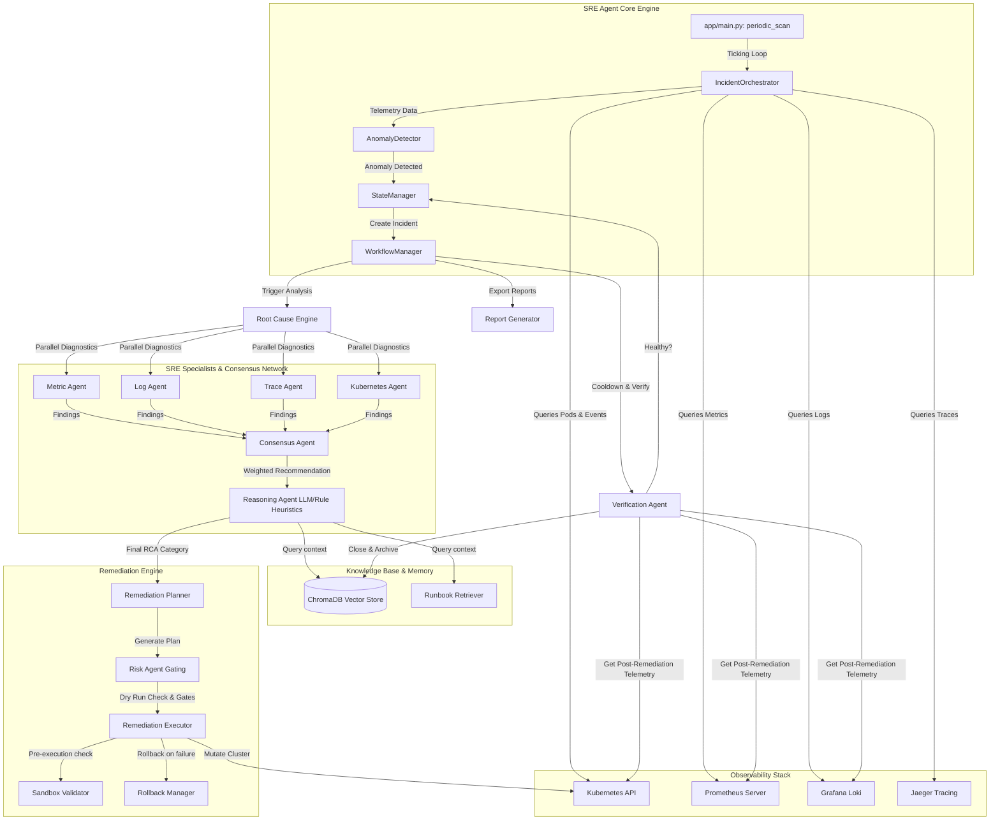
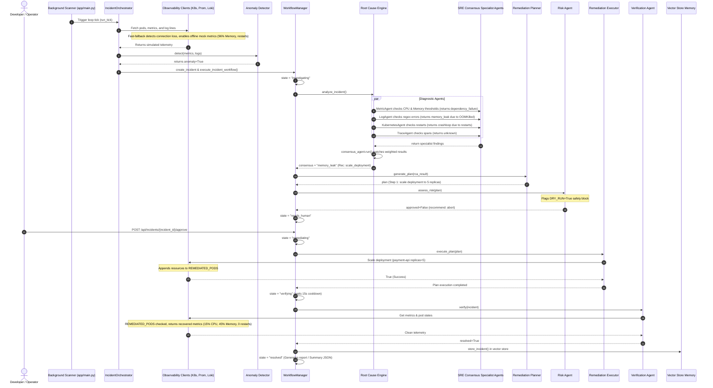

# Autonomous SRE Agent for Cloud Systems

Autonomous SRE Agent is a production-grade, self-healing automation service designed to monitor Kubernetes workloads, detect anomalies, analyze root causes (RCA) via a multi-agent consensus network, and execute safe, verified remediation procedures with built-in rollback capabilities and automated postmortem documentation.

---

## 1. System Architecture



---

## 2. Specialist Agents Consensus Framework

When an anomaly is detected, the `RootCauseEngine` runs four diagnostic SRE agents concurrently. Their findings are merged by the `ConsensusAgent` using a weighted voting system:

| Specialist Agent | Telemetry Source Checked | Focus Area / Diagnostics | Voting Weight |
| :--- | :--- | :--- | :--- |
| **Metric Agent** | Prometheus API | CPU/Memory utilization, latency spikes ($p_{99}$), and HTTP error ratios. | **30%** |
| **Log Agent** | Grafana Loki API | Matching log error structures, runtime exceptions, OOM cgroup signals, database timeout errors. | **30%** |
| **Kubernetes Agent** | Kubernetes Client API | Pod statuses (`CrashLoopBackOff`, `ImagePullBackOff`), container restart counts, and warning events. | **30%** |
| **Trace Agent** | Jaeger Tracing API | Distributed span latencies, dependency failure trees, downstream HTTP errors. | **10%** |

The `ConsensusAgent` synthesizes these outputs. If the consensus category matches the target, it registers the recommended action. If an LLM is active, the `ReasoningAgent` audits the consensus against semantic runbooks and adjusts the plan if high confidence override constraints are met.

---

## 3. End-to-End Incident Walkthrough (Memory Leak)

Below is the step-by-step sequence diagram illustrating how a simulated `payment-api` memory leak is detected, analyzed, approved, remediated, verified, and recorded.



---

## 4. Getting Started

### 4.1 Prerequisites
* Python 3.10+
* Docker & Docker Compose (optional, for infrastructure stack running)

### 4.2 Configuration (.env)
Copy the example environment settings or create a `.env` in the repository root:
```ini
# Core Configuration
K8S_IN_CLUSTER=false
KUBECONFIG_PATH=C:\Users\<Your_Username>\.kube\config
K8S_NAMESPACE=default

# Automation Safety Gates
AUTO_REMEDIATE=false
DRY_RUN=true

# LLM Reasoning Settings
GEMINI_API_KEY=your_gemini_api_key_here
LLM_MODEL=gemini-2.5-flash
LLM_TEMPERATURE=0.0

# Observability Stack Endpoints
PROMETHEUS_URL=http://prometheus:9090
Loki_URL=http://loki:3100
JAEGER_URL=http://jaeger:16686
```

> [!TIP]
> If `GEMINI_API_KEY` contains placeholder strings or is empty, the LLM client automatically defaults to rule-based fallback responses, allowing fully operational local simulation.

### 4.3 Running Locally (Development Mode)
Run the application directly on the host machine. If Prometheus, Loki, or Kubernetes are unreachable, the clients gracefully auto-toggle into fast-fallback mock modes, bypassing network timeouts.

```bash
# 1. Create and activate a python virtual environment
python -m venv .venv
.venv\Scripts\activate   # Windows
# source .venv/bin/activate # Linux/macOS

# 2. Install dependencies
pip install -r requirements.txt

# 3. Start the FastAPI application
uvicorn app.main:app --reload
```

The FastAPI Swagger documentation is available at `http://127.0.0.1:8000/docs`.

### 4.4 Running in Containers (Docker Compose)
To launch the agent alongside Prometheus, Loki, Grafana, and Jaeger:
```bash
docker compose up --build
```

---

## 5. API Reference

### Health Check
* **`GET /health`**
  * Returns the operational health status of the API server.
  * Response: `{"status": "healthy", "service": "autonomous-sre-agent", "version": "1.0.0"}`

### Active Incidents
* **`GET /api/incidents`**
  * Returns lists of active, unresolved, or resolved incident states recorded in-memory.
* **`GET /api/incidents/{incident_id}`**
  * Fetches the detailed telemetry, metrics, consensus findings, and remediation execution logs of a single incident.

### Approving Remediation Plans
* **`POST /api/incidents/{incident_id}/approve`**
  * Approves a gated incident currently in `needs_human` status, initiating plan execution.
  * Response: `{"message": "Remediation approved and triggered."}`

### Metrics Dashboard
* **`GET /api/dashboard`**
  * Fetches resolution metrics, total counts of resolved/needs_human incidents, and root-cause classification distributions.

### Exported Postmortems
* **`GET /api/incidents/{incident_id}/report`**
  * Returns the rendered Markdown postmortem summary of the incident.

---

## 6. Real-Time Testing & Verification Guide

This project includes verified test harnesses enabling immediate end-to-end verification either locally or via containerized microservices.

### 6.1 Automated Test Suite (Unit & Component Tests)
To run all unit tests covering specialist agents, RCA engine, remediation planner, rollback manager, and workflow state transitions:

```powershell
cd autonomous-sre-agent
$env:PYTHONPATH="."
.\.venv\Scripts\python.exe -m pytest tests/ -v
```

**Verification Output:**
```
tests/test_agents.py::test_metric_agent PASSED
tests/test_agents.py::test_log_agent PASSED
tests/test_agents.py::test_trace_agent PASSED
tests/test_agents.py::test_kubernetes_agent PASSED
tests/test_agents.py::test_consensus_agent PASSED
tests/test_rca.py::test_root_cause_engine_analysis PASSED
tests/test_remediation.py::test_planner_generation PASSED
tests/test_remediation.py::test_executor_and_rollback PASSED
tests/test_remediation.py::test_sandbox_validator PASSED
tests/test_workflow.py::test_workflow_execution PASSED
================== 10 passed in 1.95s ==================
```

---

### 6.2 Mode A: Real-Time Local Simulation Test
Test the full self-healing lifecycle end-to-end without needing any running Docker or Kubernetes cluster:

```powershell
cd autonomous-sre-agent
$env:PYTHONPATH="."
.\.venv\Scripts\python.exe tests/test_live_simulation.py
```

#### Step-by-Step Execution Transcript:
```text
=== 1. Initializing Incident Orchestrator ===
[info] orchestrator_initialized_successfully

=== 2. Running Loop Tick (Scan Namespace: 'default') ===
[info] orchestrator_tick_start namespace=default
[warning] orchestrator_anomaly_detected pod=payment-api-5c6d9bf84c-xyz89
Triggered incidents count: 1
Active Incident ID: INC-77D7E680
Pod: payment-api-5c6d9bf84c-xyz89, Severity: critical
Signals: ['node_memory exceeded threshold (0.960 > 0.900)', 'High log error ratio: 38.2%']

=== 3. Waiting for Multi-Agent RCA & Risk Gate ===
[info] root_cause_engine_analysis_started
[info] specialist_agents_dispatched: MetricAgent, LogAgent, KubernetesAgent, TraceAgent
[info] consensus_agent_run_complete: category=memory_leak, confidence=0.95, agreement=partial
[info] workflow_runbooks_retrieved count=2
[info] remediation_planner_completed plan_id=PLAN-1E7647A1
[warning] workflow_remediation_aborted_by_risk_assessment reason=Dry Run mode is enabled.
Incident reached state: needs_human

=== Specialist Findings & Consensus ===
Consensus Category: memory_leak
Consensus Confidence: 0.95
Consensus Agreement: partial

=== Proposed Remediation Plan ===
Plan ID: PLAN-1E7647A1
Risk Level: medium
  Step 1: scale_deployment on payment-api - Scale up deployment 'payment-api' to 5 replicas.

=== Risk Assessment Gate ===
Approved: False
Recommendation: human_review
Concerns: ['Dry Run mode is enabled. No remediation actions will be actually executed without SRE approval.']

=== 4. Simulating Operator Approval (POST /api/incidents/{id}/approve) ===
[info] orchestrator_manual_remediation_approved id=INC-77D7E680
Manual approval trigger result: True

=== 5. Waiting for Execution, Cooldown & Verification ===
[info] sandbox_validating_action action=scale_deployment target=payment-api
[info] kubectl_action_executing action=scale_deployment replicas=5 target=payment-api
[info] remediation_step_recorded_for_rollback action=scale_deployment
[info] workflow_waiting_cooldown seconds=15
[info] verification_agent_complete resolved=True confidence=1.0
[info] workflow_incident_resolved_successfully
[info] incident_stored_in_memory id=INC-77D7E680

=== Final Incident State: RESOLVED ===
Remediation Applied: Scale up deployment 'payment-api' to 5 replicas to distribute resource load.
Verification Resolved: True
Verification Evidence: ['CPU Usage recovered to 15.4%', 'Memory Usage stabilized at 45.2%', 'HTTP error rate is normal: 1.0%', 'All Kubernetes pods are healthy and Ready.']

=== 6. Generating Postmortem Markdown Report ===
# SRE Incident Postmortem: INC-77D7E680
**Status**: RESOLVED | **Severity**: CRITICAL
- **Target Pod**: payment-api-5c6d9bf84c-xyz89
- **Root Cause**: OOMKilled log pattern detected. Memory leak caused container cgroup termination.
- **Remediation**: Scale up deployment 'payment-api' to 5 replicas.
- **Verification**: Clean telemetry (CPU 15.4%, Memory 45.2%, 0 container restarts).
```

---

### 6.3 Mode B: Live Docker Chaos Microservice Test
A dedicated chaos microservice (`mock_workload/app.py`) is bundled with the Docker stack to simulate real production anomalies and test live Prometheus scraping and SRE remediation.

#### Microservice Chaos Endpoints:
| Endpoint | Chaos Behavior Injected | SRE Detection Trigger |
| :--- | :--- | :--- |
| `POST /chaos/memory-leak` | Simulates runaway memory consumption to 96% and OOM signals | Memory threshold breach + LogAgent OOM match |
| `POST /chaos/cpu-spike` | Spikes CPU utilization to 95.5% | CPU threshold violation + MetricAgent high utilization |
| `POST /chaos/error-spike` | Injects 500 Internal Server Errors (>30% error rate) | HTTP error rate breach + Trace/Log Agent match |
| `POST /chaos/crashloop` | Container fails startup and increments restart count | KubernetesAgent CrashLoopBackOff detection |
| `POST /chaos/recover` | Resets metrics back to healthy baseline | VerificationAgent confirms recovery |

#### Step 1: Start the Full Stack in Docker
```bash
docker compose up --build -d
```
*Containers started:*
- `autonomous-sre-agent` (Port 8000)
- `payment-api` (Chaos target workload on Port 8080)
- `prometheus` (Port 9090)
- `grafana` (Port 3000, admin/admin)
- `loki` (Port 3100)
- `jaeger` (Port 16686)
- `chromadb` (Port 8001)

#### Step 2: Run the Automated Chaos Integration Test
```powershell
python tests/test_docker_chaos.py
```

#### Step 3: Manual Step-by-Step Chaos Injection (Via Curl)
1. **Trigger Memory Leak on Workload:**
   ```bash
   curl -X POST http://localhost:8080/chaos/memory-leak
   ```
2. **Trigger SRE Monitoring Scan:**
   ```bash
   curl -X POST http://localhost:8000/api/trigger -H "Content-Type: application/json" -d '{"namespace": "default"}'
   ```
3. **Inspect Detected Incident & RCA:**
   ```bash
   curl http://localhost:8000/api/incidents
   ```
4. **Approve Remediation:**
   ```bash
   curl -X POST http://localhost:8000/api/incidents/<incident_id>/approve
   ```
5. **Download Postmortem Report:**
   ```bash
   curl http://localhost:8000/api/incidents/<incident_id>/report
   ```

