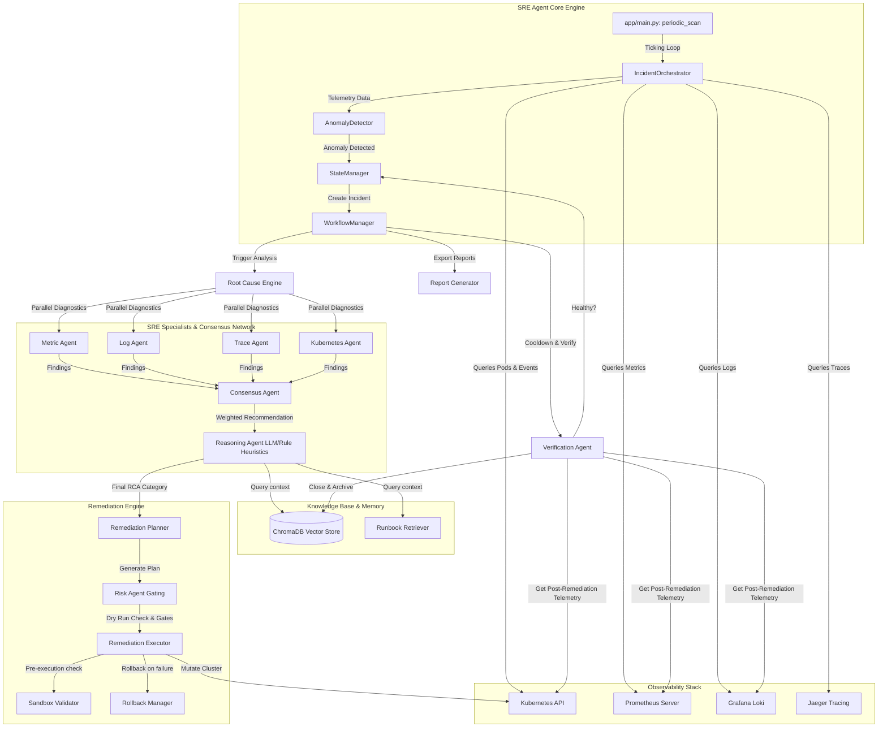

# Autonomous SRE Agent for Cloud Systems

Autonomous SRE Agent is a production-grade, self-healing automation service designed to monitor Kubernetes workloads, detect anomalies, analyze root causes (RCA) via a multi-agent consensus network, and execute safe, verified remediation procedures with built-in rollback capabilities and automated postmortem documentation.

---

## 1. System Architecture



---

## 2. Specialist Agents Consensus Framework

When an anomaly is detected, the `RootCauseEngine` runs four diagnostic SRE agents concurrently. Their findings are merged by the `ConsensusAgent` using a weighted voting system:

| Specialist Agent | Telemetry Source Checked | Focus Area / Diagnostics | Voting Weight |
| :--- | :--- | :--- | :--- |
| **Metric Agent** | Prometheus API | CPU/Memory utilization, latency spikes ($p_{99}$), and HTTP error ratios. | **30%** |
| **Log Agent** | Grafana Loki API | Matching log error structures, runtime exceptions, OOM cgroup signals, database timeout errors. | **30%** |
| **Kubernetes Agent** | Kubernetes Client API | Pod statuses (`CrashLoopBackOff`, `ImagePullBackOff`), container restart counts, and warning events. | **30%** |
| **Trace Agent** | Jaeger Tracing API | Distributed span latencies, dependency failure trees, downstream HTTP errors. | **10%** |

The `ConsensusAgent` synthesizes these outputs. If the consensus category matches the target, it registers the recommended action. If an LLM is active, the `ReasoningAgent` audits the consensus against semantic runbooks and adjusts the plan if high confidence override constraints are met.

---

## 3. End-to-End Incident Walkthrough (Memory Leak)

Below is the step-by-step sequence diagram illustrating how a simulated `payment-api` memory leak is detected, analyzed, approved, remediated, verified, and recorded.

```mermaid
sequenceDiagram
    autonumber
    actor Developer as Developer / Operator
    participant Scanner as Background Scanner (app/main.py)
    participant Orch as IncidentOrchestrator
    participant Clients as Observability Clients (K8s, Prom, Loki)
    participant Detector as Anomaly Detector
    participant Workflow as WorkflowManager
    participant RCA as Root Cause Engine
    participant Agents as SRE Consensus Specialist Agents
    participant Planner as Remediation Planner
    participant Risk as Risk Agent
    participant Exec as Remediation Executor
    participant Verify as Verification Agent
    participant Memory as Vector Store Memory

    %% Phase 1: Detection
    Scanner->>Orch: Trigger loop tick (run_tick)
    Orch->>Clients: Fetch pods, metrics, and log lines
    Note over Clients: Fast-fallback detects connection loss,<br/>enabling offline mock metrics (96% Memory, restarts)
    Clients-->>Orch: Returns simulated telemetry
    Orch->>Detector: detect(metrics, logs)
    Detector-->>Orch: returns anomaly=True
    Orch->>Workflow: create_incident & execute_incident_workflow()
    
    %% Phase 2: RCA & Plan
    Workflow->>Workflow: state = "investigating"
    Workflow->>RCA: analyze_incident()
    par Diagnostic Agents
        RCA->>Agents: MetricAgent checks CPU & Memory thresholds (returns dependency_failure)
        RCA->>Agents: LogAgent checks regex errors (returns memory_leak due to OOMKilled)
        RCA->>Agents: KubernetesAgent checks restarts (returns crashloop due to restarts)
        RCA->>Agents: TraceAgent checks spans (returns unknown)
    end
    Agents-->>RCA: return specialist findings
    RCA->>RCA: consensus_agent.run() matches weighted results
    RCA-->>Workflow: consensus = "memory_leak" (Rec: scale_deployment)
    Workflow->>Planner: generate_plan(rca_result)
    Planner-->>Workflow: plan (Step 1: scale deployment to 5 replicas)
    Workflow->>Risk: assess_risk(plan)
    Note over Risk: Flags DRY_RUN=True safety block
    Risk-->>Workflow: approved=False (recommend: abort)
    Workflow->>Workflow: state = "needs_human"
    
    %% Phase 3: Human Gating & Execution
    Developer->>Workflow: POST /api/incidents/{incident_id}/approve
    Workflow->>Workflow: state = "remediating"
    Workflow->>Exec: execute_plan(plan)
    Exec->>Clients: Scale deployment (payment-api replicas=5)
    Note over Clients: Appends resources to REMEDIATED_PODS
    Clients-->>Exec: True (Success)
    Exec-->>Workflow: Plan execution completed
    
    %% Phase 4: Verification
    Workflow->>Workflow: state = "verifying" (waits 15s cooldown)
    Workflow->>Verify: verify(incident)
    Verify->>Clients: Get metrics & pod states
    Note over Clients: REMEDIATED_PODS checked;<br/>returns recovered metrics (15% CPU, 45% Memory, 0 restarts)
    Clients-->>Verify: Clean telemetry
    Verify-->>Workflow: resolved=True
    Workflow->>Memory: store_incident() in vector store
    Workflow->>Workflow: state = "resolved" (Generates report / Summary JSON)
```

---

## 4. Getting Started

### 4.1 Prerequisites
* Python 3.10+
* Docker & Docker Compose (optional, for infrastructure stack running)

### 4.2 Configuration (.env)
Copy the example environment settings or create a `.env` in the repository root:
```ini
# Core Configuration
K8S_IN_CLUSTER=false
KUBECONFIG_PATH=C:\Users\<Your_Username>\.kube\config
K8S_NAMESPACE=default

# Automation Safety Gates
AUTO_REMEDIATE=false
DRY_RUN=true

# LLM Reasoning Settings
ANTHROPIC_API_KEY=your_anthropic_api_key_here
LLM_MODEL=claude-3-haiku-20240307
LLM_TEMPERATURE=0.0

# Observability Stack Endpoints
PROMETHEUS_URL=http://prometheus:9090
Loki_URL=http://loki:3100
JAEGER_URL=http://jaeger:16686
```

> [!TIP]
> If `ANTHROPIC_API_KEY` contains placeholder strings or is empty, the LLM client automatically defaults to rule-based fallback responses, allowing fully operational local simulation.

### 4.3 Running Locally (Development Mode)
Run the application directly on the host machine. If Prometheus, Loki, or Kubernetes are unreachable, the clients gracefully auto-toggle into fast-fallback mock modes, bypassing network timeouts.

```bash
# 1. Create and activate a python virtual environment
python -m venv .venv
.venv\Scripts\activate   # Windows
# source .venv/bin/activate # Linux/macOS

# 2. Install dependencies
pip install -r requirements.txt

# 3. Start the FastAPI application
uvicorn app.main:app --reload
```

The FastAPI Swagger documentation is available at `http://127.0.0.1:8000/docs`.

### 4.4 Running in Containers (Docker Compose)
To launch the agent alongside Prometheus, Loki, Grafana, and Jaeger:
```bash
docker compose up --build
```

---

## 5. API Reference

### Health Check
* **`GET /health`**
  * Returns the operational health status of the API server.
  * Response: `{"status": "healthy", "service": "autonomous-sre-agent", "version": "1.0.0"}`

### Active Incidents
* **`GET /api/incidents`**
  * Returns lists of active, unresolved, or resolved incident states recorded in-memory.
* **`GET /api/incidents/{incident_id}`**
  * Fetches the detailed telemetry, metrics, consensus findings, and remediation execution logs of a single incident.

### Approving Remediation Plans
* **`POST /api/incidents/{incident_id}/approve`**
  * Approves a gated incident currently in `needs_human` status, initiating plan execution.
  * Response: `{"message": "Remediation approved and triggered."}`

### Metrics Dashboard
* **`GET /api/dashboard`**
  * Fetches resolution metrics, total counts of resolved/needs_human incidents, and root-cause classification distributions.

### Exported Postmortems
* **`GET /api/incidents/{incident_id}/report`**
  * Returns the rendered Markdown postmortem summary of the incident.
