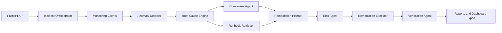

# Architecture

## Overview
The Autonomous SRE Agent is a FastAPI service that orchestrates monitoring, anomaly detection,
root cause analysis, remediation planning, and verification across Kubernetes workloads.

## Core Components
- **API Layer**: FastAPI endpoints for health checks, incident retrieval, and manual triggers.
- **Monitoring Clients**: Prometheus, Loki, Jaeger, and Kubernetes API integrations.
- **Anomaly Detection**: Threshold checks and Isolation Forest for metric anomalies.
- **RCA Engine**: Specialist agents (metric, log, trace, kubernetes) with consensus.
- **Runbook System**: Markdown runbooks indexed in ChromaDB for retrieval.
- **Remediation**: Planner, risk assessment, executor, and rollback manager.
- **Verification**: Post-remediation checks to confirm recovery.
- **Reporting**: Markdown postmortem reports and dashboard summary export.

## Data Flow

## Deployment Modes
- **Docker Compose**: Local development with Prometheus, Loki, Grafana, Jaeger, and ChromaDB.
- **Kubernetes**: Deployment and service with RBAC for pod, deployment, and node operations.

## Safety Boundaries
- Remediation is gated by risk assessment.
- Automatic remediation is disabled by default.
- Manual approval is required when risk is high or confidence is low.
