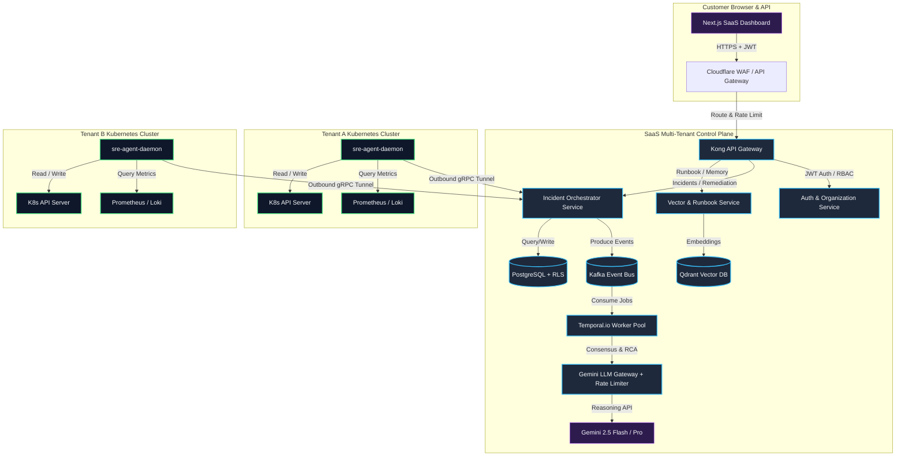
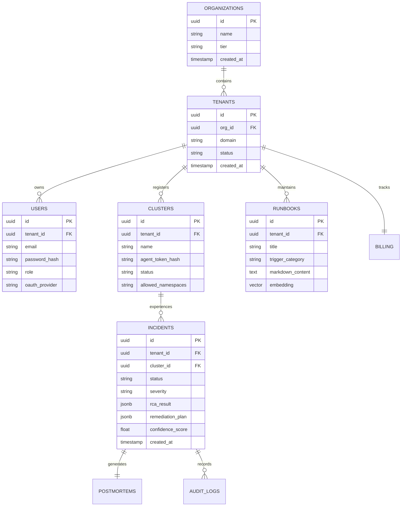
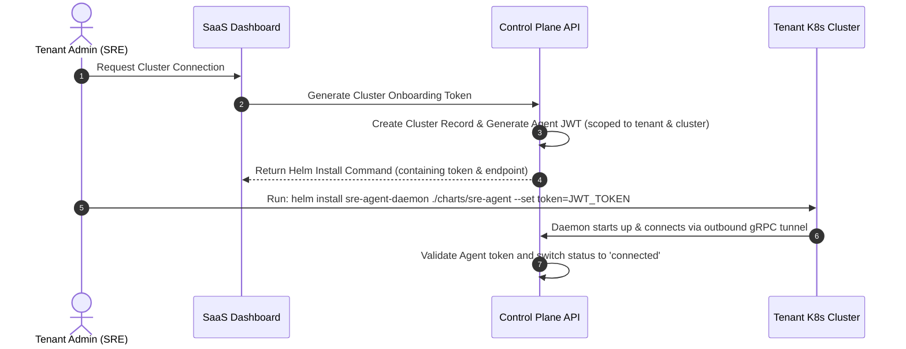
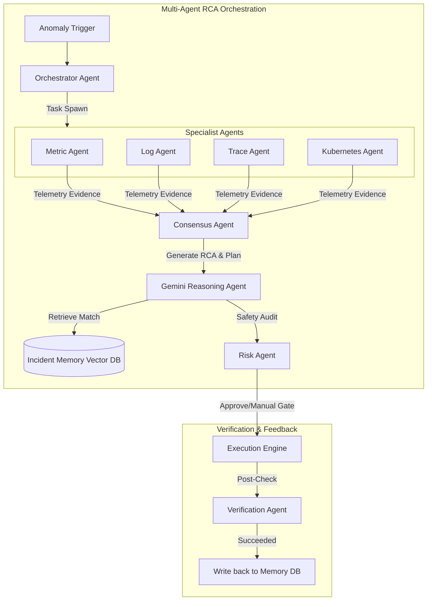
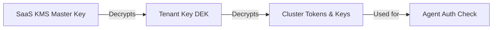
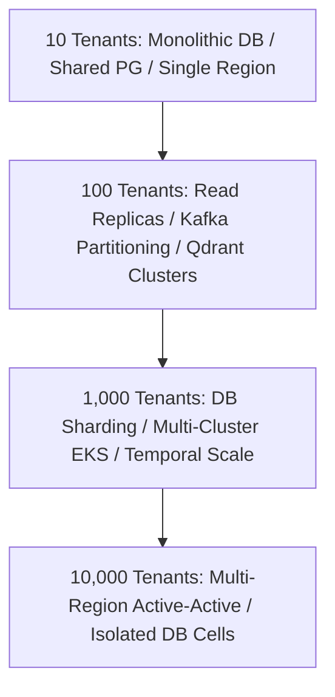

# Autonomous SRE Agent: Level-3 SaaS Architecture Design

This document details the production-grade, enterprise-ready system architecture to transform the single-user **Autonomous SRE Agent** into a **Level-3 Multi-Tenant SaaS Platform**. The platform will enable hundreds of organizations to securely connect their Kubernetes clusters, monitor system state, automate root cause analysis (RCA) via a multi-agent consensus network, retrieve context-aware runbooks, and perform gated, risk-aware remediations.

---

## 1. System & SaaS Architecture

### 1.1 High-Level SaaS Control Plane & Data Plane Architecture

The SaaS architecture utilizes a split-plane design:
*   **Control Plane (SaaS Hosted)**: Manages authentication, tenant metadata, incident history, runbooks, metrics analysis orchestration, multi-agent reasoning, risk models, and billing.
*   **Data Plane (Customer Clusters)**: Runs a lightweight agent daemon (`sre-agent-daemon`) inside customer namespaces. It communicates with the Control Plane using a secure outbound connection (gRPC/WebSockets) to execute read-only metrics queries and safe, authorized remediation actions. This eliminates the need for customers to expose inbound API ports or upload raw `kubeconfig` files.



---

## 2. Multi-Tenant Isolation Strategy

Tenant isolation is critical for security, performance, and compliance. We adopt a **Logical Separation with Row-Level Security (RLS)** in PostgreSQL for high density, and **Separate Database Instances** for Enterprise tiers.

### 2.1 Storage Isolation Matrix
| Tier | Database Isolation | Vector DB Isolation | Event Queue Isolation | Log / Metric Isolation |
| :--- | :--- | :--- | :--- | :--- |
| **Free / Pro** | Shared PG Instance with PostgreSQL Row-Level Security (RLS) on `tenant_id` | Shared Qdrant cluster with tenant-partitioned namespaces / metadata | Shared Kafka cluster with tenant-keyed messages and topic-level isolation | Virtual multi-tenancy using Grafana Mimir and Loki tenant headers |
| **Enterprise** | Dedicated PostgreSQL replica / database schema | Dedicated Qdrant Collection (isolated disk storage) | Dedicated Kafka Topics | Dedicated Mimir/Loki ingestion pipelines and storage buckets |

### 2.2 Enabling PostgreSQL Row-Level Security (RLS)
Every multi-tenant table must include a `tenant_id` column. We enforce isolation at the database engine level by enabling RLS policies:

```sql
-- Enable Row-Level Security on critical tables
ALTER TABLE tenant_incidents ENABLE ROW LEVEL SECURITY;
ALTER TABLE tenant_runbooks ENABLE ROW LEVEL SECURITY;

-- Create policy to restrict access based on current tenant context
CREATE POLICY tenant_isolation_policy ON tenant_incidents
    FOR ALL
    USING (tenant_id = current_setting('app.current_tenant_id', true));
```

During request context initialization, the API Gateway inserts the decrypted `tenant_id` from the JWT token into the connection session settings:
```python
# FastAPI Dependency for Database Session binding
async def get_db_session(request: Request):
    tenant_id = request.state.tenant_id
    db = sessionmaker()
    db.execute(text(f"SET LOCAL app.current_tenant_id = '{tenant_id}';"))
    try:
        yield db
    finally:
        db.close()
```

---

## 3. Data Model Design

The relational database manages system configuration, organizations, audit logs, incidents, and approvals.

### 3.1 Entity-Relationship Diagram (ERD)



### 3.2 SQL DDL (PostgreSQL Schema)

```sql
-- Extensions required
CREATE EXTENSION IF NOT EXISTS "uuid-ossp";
CREATE EXTENSION IF NOT EXISTS "vector"; -- pgvector for embedding search

-- 1. Organizations
CREATE TABLE organizations (
    id UUID PRIMARY KEY DEFAULT uuid_generate_v4(),
    name VARCHAR(255) NOT NULL,
    tier VARCHAR(50) NOT NULL DEFAULT 'free', -- free, pro, enterprise
    created_at TIMESTAMP WITH TIME ZONE DEFAULT CURRENT_TIMESTAMP
);

-- 2. Tenants (Multi-tenant partition key)
CREATE TABLE tenants (
    id UUID PRIMARY KEY DEFAULT uuid_generate_v4(),
    org_id UUID REFERENCES organizations(id) ON DELETE CASCADE,
    subdomain VARCHAR(100) UNIQUE NOT NULL,
    status VARCHAR(50) NOT NULL DEFAULT 'active',
    created_at TIMESTAMP WITH TIME ZONE DEFAULT CURRENT_TIMESTAMP
);
CREATE INDEX idx_tenants_org ON tenants(org_id);

-- 3. Users with RBAC
CREATE TABLE users (
    id UUID PRIMARY KEY DEFAULT uuid_generate_v4(),
    tenant_id UUID REFERENCES tenants(id) ON DELETE CASCADE,
    email VARCHAR(255) UNIQUE NOT NULL,
    password_hash VARCHAR(255),
    role VARCHAR(50) NOT NULL DEFAULT 'viewer', -- admin, sre_engineer, viewer
    oauth_provider VARCHAR(50) DEFAULT 'local', -- local, google, github
    created_at TIMESTAMP WITH TIME ZONE DEFAULT CURRENT_TIMESTAMP
);
CREATE INDEX idx_users_tenant ON users(tenant_id);

-- 4. Clusters Connected
CREATE TABLE clusters (
    id UUID PRIMARY KEY DEFAULT uuid_generate_v4(),
    tenant_id UUID REFERENCES tenants(id) ON DELETE CASCADE,
    name VARCHAR(100) NOT NULL,
    agent_token_hash VARCHAR(255) NOT NULL,
    status VARCHAR(50) NOT NULL DEFAULT 'disconnected',
    allowed_namespaces TEXT[] DEFAULT ARRAY['default'],
    created_at TIMESTAMP WITH TIME ZONE DEFAULT CURRENT_TIMESTAMP
);
CREATE INDEX idx_clusters_tenant ON clusters(tenant_id);

-- 5. Incidents
CREATE TABLE incidents (
    id UUID PRIMARY KEY DEFAULT uuid_generate_v4(),
    tenant_id UUID REFERENCES tenants(id) ON DELETE CASCADE,
    cluster_id UUID REFERENCES clusters(id) ON DELETE CASCADE,
    status VARCHAR(50) NOT NULL DEFAULT 'investigating', -- investigating, rca_in_progress, needs_human, remediating, resolved, failed
    severity VARCHAR(50) NOT NULL DEFAULT 'warning',
    rca_result JSONB,
    remediation_plan JSONB,
    confidence_score NUMERIC(5, 2) DEFAULT 0.00,
    created_at TIMESTAMP WITH TIME ZONE DEFAULT CURRENT_TIMESTAMP,
    updated_at TIMESTAMP WITH TIME ZONE DEFAULT CURRENT_TIMESTAMP
);
CREATE INDEX idx_incidents_tenant_status ON incidents(tenant_id, status);

-- 6. Tenant Runbooks
CREATE TABLE runbooks (
    id UUID PRIMARY KEY DEFAULT uuid_generate_v4(),
    tenant_id UUID REFERENCES tenants(id) ON DELETE CASCADE,
    title VARCHAR(255) NOT NULL,
    trigger_category VARCHAR(100) NOT NULL,
    markdown_content TEXT NOT NULL,
    embedding VECTOR(1536), -- Vector embeddings for semantic search
    created_at TIMESTAMP WITH TIME ZONE DEFAULT CURRENT_TIMESTAMP
);
CREATE INDEX idx_runbooks_tenant ON runbooks(tenant_id);

-- 7. Audit Logs for Compliance
CREATE TABLE audit_logs (
    id UUID PRIMARY KEY DEFAULT uuid_generate_v4(),
    tenant_id UUID REFERENCES tenants(id) ON DELETE CASCADE,
    user_id UUID REFERENCES users(id) ON DELETE SET NULL,
    action VARCHAR(255) NOT NULL, -- approve_remediation, onboard_cluster, etc.
    details JSONB,
    ip_address VARCHAR(45),
    created_at TIMESTAMP WITH TIME ZONE DEFAULT CURRENT_TIMESTAMP
);
CREATE INDEX idx_audit_logs_tenant ON audit_logs(tenant_id);
```

---

## 4. Cluster Onboarding & Agent Architecture

Connecting customer Kubernetes workloads requires high security. We avoid raw Kubeconfig uploads to the cloud. Instead, we implement an **Agent-based Pull/Push Tunnel Architecture**.

### 4.1 Onboarding Workflow



### 4.2 The In-Cluster Agent (`sre-agent-daemon`)
The agent runs in the customer cluster as a lightweight Go or Python deployment. It maintains a persistent gRPC bidirectional stream with the SaaS Control Plane.

#### Security Properties:
*   **Zero Inbound Ports**: No firewall configuration needed. It only opens outbound TCP connections over HTTPS/gRPC to `https://agent.sre-platform.com`.
*   **Least Privilege RBAC**: The agent is bound to a specific Kubernetes Namespace via a ClusterRole/Role. By default, it cannot inspect other namespaces.
*   **Encrypted Tunneling**: All metrics, logs, and trace requests from the SaaS engine are sent through the bidirectional gRPC channel, and results are returned securely.
*   **Namespace Constraints**: The agent's service account restricts write/remediation capabilities (e.g. only restarts, scale-up, or safe rolling deployments) in designated app namespaces.

---

## 5. API Design

The control plane exposes a RESTful API versioned under `/api/v1`.

### 5.1 Endpoints Specification

#### 1. Cluster Onboarding
*   **`POST /api/v1/clusters`**
    *   **Description**: Registers a cluster and returns the onboarding manifest/token.
    *   **RBAC**: `admin`
    *   **Request Payload**:
        ```json
        {
          "name": "production-us-east-1",
          "allowed_namespaces": ["frontend", "payment", "auth"]
        }
        ```
    *   **Response (201 Created)**:
        ```json
        {
          "cluster_id": "4b6c3822-79ee-47d3-95ee-fb8bda86d5ab",
          "agent_token": "eyJhbGciOiJIUzI1NiIsInR5cCI6IkpXVCJ9...",
          "helm_command": "helm repo add sre-agent https://charts.sre-platform.com && helm install sre-agent-daemon sre-agent/sre-agent-daemon --set token=eyJhbGciOiJIUzI1NiIsInR5cCI6IkpXVCJ9... --set endpoint=agent.sre-platform.com"
        }
        ```

#### 2. Incidents List & Status
*   **`GET /api/v1/incidents`**
    *   **Description**: Retrieve current/historical incidents for the tenant.
    *   **RBAC**: `viewer`, `sre_engineer`, `admin`
    *   **Query Parameters**: `status`, `severity`, `limit`, `offset`
    *   **Response (200 OK)**:
        ```json
        [
          {
            "id": "18f97210-67f1-432d-886d-f421f1c8417c",
            "cluster_id": "4b6c3822-79ee-47d3-95ee-fb8bda86d5ab",
            "status": "needs_human",
            "severity": "critical",
            "confidence_score": 0.89,
            "created_at": "2026-06-05T19:00:00Z"
          }
        ]
        ```

#### 3. Root Cause Analysis Summary
*   **`GET /api/v1/incidents/{incident_id}/rca`**
    *   **Description**: Fetch multi-agent generated Root Cause Analysis.
    *   **RBAC**: `viewer`, `sre_engineer`, `admin`
    *   **Response (200 OK)**:
        ```json
        {
          "incident_id": "18f97210-67f1-432d-886d-f421f1c8417c",
          "root_cause_category": "Database Connection Pool Exhaustion",
          "evidence": {
            "metrics": "PostgreSQL connection count spiked to 98% of max_connections.",
            "logs": "OperationalError: FATAL: remaining connection slots are reserved for non-replication superuser connections"
          },
          "agents_consensus": {
            "metric_agent": "exhaustion",
            "log_agent": "exhaustion",
            "consensus_status": "agreed"
          }
        }
        ```

#### 4. Remediation Approval
*   **`POST /api/v1/incidents/{incident_id}/remediations/approve`**
    *   **Description**: Human-in-the-loop approval to run remediation plan.
    *   **RBAC**: `sre_engineer`, `admin`
    *   **Request Payload**:
        ```json
        {
          "notes": "Approving rollout restart for microservice pods to release connections."
        }
        ```
    *   **Response (202 Accepted)**:
        ```json
        {
          "task_id": "ef273be8-bf01-4475-ba7e-398df981ab23",
          "status": "executing",
          "remediation_action": "rollout_restart"
        }
        ```

---

## 6. Microservice & Directory Architecture

To handle workloads asynchronously, the application is split into discrete domain-driven microservices.

### 6.1 Microservices Structure
1.  **Auth & IAM Service**: Handles signup, logins, tenant lifecycle, user invites, OIDC (Google/Github), and session validation.
2.  **API Gateway (Kong)**: Directs requests, handles rate limiting, decrypts JWTs, and adds `X-Tenant-Id` header.
3.  **Incident Orchestrator Service**: Core engine receiving anomaly triggers (alerts), driving RCA and consensus loops.
4.  **Agent Gateway**: Manages active bidirectional TCP/gRPC streams to/from in-cluster agents.
5.  **Vector DB & Runbook Service**: Ingests, embeds, and queries runbooks and incident memory.
6.  **Notification Engine**: Dispatches alerts to Slack, PagerDuty, and email via webhooks.

### 6.2 Repository Directory Layout (Mono-repo / Multi-service approach)

```
autonomous-sre-platform/
├── apps/
│   ├── auth-service/                # Python/FastAPI Auth Service
│   ├── orchestrator-service/        # Python/FastAPI Core SRE orchestrator
│   ├── agent-gateway/               # Go gRPC tunnel server
│   ├── runbook-service/             # Python semantic embedding & Chroma/Qdrant agent
│   └── web-dashboard/               # Next.js / TypeScript Frontend UI
├── agents/
│   └── sre-agent-daemon/            # Daemon deployed inside tenant clusters
├── shared/
│   ├── proto/                       # Protocol Buffers definitions for Agent tunnel
│   └── python-sdk/                  # Shared logger, metrics, security & DB layers
├── k8s/
│   ├── helm/                        # Helm charts for Control Plane and Agent
│   └── network-policies.yaml        # Tenant-isolated network configurations
├── docker-compose.yml               # Local multi-tenant test setup
└── README.md
```

---

## 7. AI & Multi-Agent SaaS Design

The AI architecture scales up the specialist SRE agent system to work safely in a multi-tenant environment.



### 7.1 Multi-Agent Flow Enhancements
1.  **Metric, Log, Trace, and Kubernetes Agents**: Instead of talking directly to databases, they submit gRPC fetch queries to the `Agent Gateway` for the specific `cluster_id`. The Gateway passes the fetch instructions to the in-cluster `sre-agent-daemon` which runs them locally.
2.  **Chroma/Qdrant Incident Memory Isolation**: We search similar historical incidents by supplying a filter mapping strictly to the current tenant:
    ```python
    search_results = qdrant_client.search(
        collection_name="incidents",
        query_vector=incident_embedding,
        query_filter=Filter(
            must=[FieldCondition(key="tenant_id", match=MatchValue(value=tenant_id))]
        )
    )
    ```
3.  **Auto Runbook Generation**: When an incident is resolved via manual intervention, the platform records the executed command sequence and sends it to the Gemini 2.5 Pro model to generate a polished markdown runbook, storing it in the tenant's private runbook repository.
4.  **Hallucination Prevention**: The system utilizes a dual-check validation pipeline:
    *   **Telemetry Verification**: Every generated RCA claim must be backed by a specific metric name/value or log snippet captured from the telemetry logs. If no explicit backing data exists in the orchestrator state, the platform flags the confidence score as `low` and requests human review.
    *   **Action Sandbox Testing**: Proposed remediation scripts undergo a Dry-Run syntax schema validation before deployment.

---

## 8. Production Infrastructure & Deployment

We target deployment on **AWS Elastic Kubernetes Service (EKS)** or **Google Kubernetes Engine (GKE)** using Helm and ArgoCD.

### 8.1 Ingress, Service Mesh, and Routing
*   **Global Routing**: Cloudflare DNS manages Geo-Routing.
*   **API Gateway & WAF**: Cloudflare WAF handles DDoS protection and rate limits. Traffic passes to a **Kong API Gateway** running inside the SaaS cluster.
*   **Service Mesh (Istio)**: Enforces mutual TLS (mTLS) for all service-to-service calls inside the control plane. Egress traffic to LLM APIs is audited and rate-limited.

### 8.2 Monitoring, Logging, and Tracing (Multi-Tenant Observability)
*   **Telemetry Ingestion**: Grafana Mimir (metrics), Loki (logs), and Tempo (traces) receive cluster data.
*   **Tenant Authentication**: Data sent from the in-cluster agent is injected with `X-Scope-OrgID: <tenant_id>` headers. Mimir and Loki automatically partition data by this header.
*   **Dashboards**: Grafana dashboards use variable substitution to dynamically load data based on the authenticated tenant.

### 8.3 Disaster Recovery (DR) and High Availability (HA)
*   **PostgreSQL**: Configured with Multi-AZ primary and replica instances. Continuous WAL backups to AWS S3 via pgBackRest (RPO < 5 mins, RTO < 30 mins).
*   **Qdrant**: Runs in a distributed cluster across three availability zones.
*   **Regional Failover**: In the event of a cloud region outage, DNS switches to the secondary DR region where read-replicas are promoted to primary.

---

## 9. Security Design

A Zero-Trust architecture ensures absolute tenant separation and data confidentiality.

### 9.1 Data Encryption
*   **In Transit**: Enforced TLS 1.3 for all REST API and gRPC connections.
*   **At Rest**: PostgreSQL data volumes and Qdrant storage are encrypted using AES-256 via Cloud Provider KMS (Key Management Service).
*   **Tenant Envelope Encryption**: For highly sensitive fields (like cluster agent tokens or customer credentials), the database stores double-encrypted payloads. A master key encrypts a unique Data Encryption Key (DEK) for each tenant.

### 9.2 Key Management Workflow



### 9.3 Audit Trail and API Security
*   **Immutable Audit Logs**: Actions like approvals, cluster registrations, and runbook updates are written to a write-once-read-many (WORM) PostgreSQL partition.
*   **OAuth2 / OpenID Connect**: Integration with Clerk/Auth0 provides safe user logins, supporting Multi-Factor Authentication (MFA).

---

## 10. Business & Pricing Model

To ensure monetization, we design a usage-based tiering system.

### 10.1 Tier Classification
| Feature | Free Tier | Pro Tier | Enterprise Tier |
| :--- | :--- | :--- | :--- |
| **Price** | $0/month | $499/month | Custom (Contact Sales) |
| **Max Connected Clusters** | 1 Cluster | Up to 10 Clusters | Unlimited |
| **Max Incidents / Month** | 50 Incidents | 1,000 Incidents | Unlimited |
| **Agent Executions** | Read-Only (RCA) | Automatic Remediation | Custom Actions + SLA |
| **Retention Policy** | 7 Days | 30 Days | 365 Days (Dedicated Bucket) |
| **Support** | Community | Slack + 12h Email | Dedicated Account Manager, 24/7 Pager |

---

## 11. Scalability Plan

We partition our scaling strategy into 4 discrete phases based on active tenants.



### 11.1 Scaling Details
*   **At 10 Customers**: Standard Python/FastAPI pods running on EKS. Shared RDS instance with Row-Level Security. Single-node Qdrant DB.
*   **At 100 Customers**: Scaled database to include read-replicas. Kafka cluster size increased with specific partitions per tenant-tier. Qdrant deployed as a 3-node HA cluster.
*   **At 1,000 Customers**: Split databases horizontally. Premium customers get dedicated PostgreSQL databases (Silo Pattern). Control plane deployed across multiple Kubernetes clusters. Temporal workflow execution pool scaled dynamically using KEDA metrics.
*   **At 10,000 Customers**: Cells architecture. The SaaS platform is partitioned into "Cells" (each cell hosting 1,000 tenants). This limits blast radius. Global routing layer maps users to their designated cell.

---

## 12. Research Contribution & Novel Components

To make this architecture and its AI engine publication-worthy, we propose three novel research contributions:

1.  **Federated Collaborative Incident Memory**: Designing a framework where anonymized incident symptoms, root causes, and successful remediation steps can be securely shared *across* different enterprise tenant memories (using federated learning or privacy-preserving semantic similarity checks) without leaking proprietary configuration or telemetry data.
2.  **Multi-Agent Consensus under High LLM Variance**: Defining a mathematical voting and consistency algorithm that handles varying reasoning results from multiple independent specialist LLM agents (Metric, Log, Trace, K8s) and converges on a verifiable RCA with an attached Confidence Metric.
3.  **RLSF (Reinforcement Learning from SRE Feedback)**: Designing a loop where SRE approvals/rejections of remediation steps continuously train the confidence grading agent and fine-tune the planning model's risk tolerance.

---

## 13. Project Roadmap

```
Phase 1: Foundation (M1-M2)
  ├── Auth, RBAC Setup, Tenant Metadata Models
  └── Single-tenant orchestrator refactored to accept context headers
Phase 2: Multi-Tenancy & Clustering (M3-M4)
  ├── Row-Level Security in DB, Qdrant Partitioning
  └── gRPC outbound Tunnel Gateway implementation
Phase 3: Agentic Consensus & AI Tuning (M5-M6)
  ├── Multi-agent RCA integration with Temporal workflows
  └── Risk-aware gating and Slack approval notifications
Phase 4: Enterprise & Compliance (M7-M8)
  ├── Audit Trails, Envelope Encryption, KMS
  └── Grafana Mimir and Loki multi-tenant ingestion
Phase 5: Scale, Peak Optimization & Launch (M9-M10)
  └── Multi-region failover, load testing, billing integration
```
